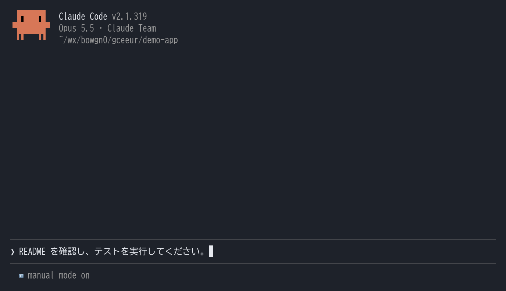
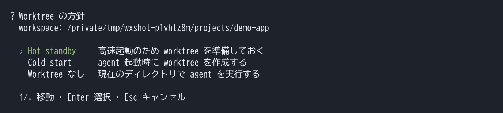
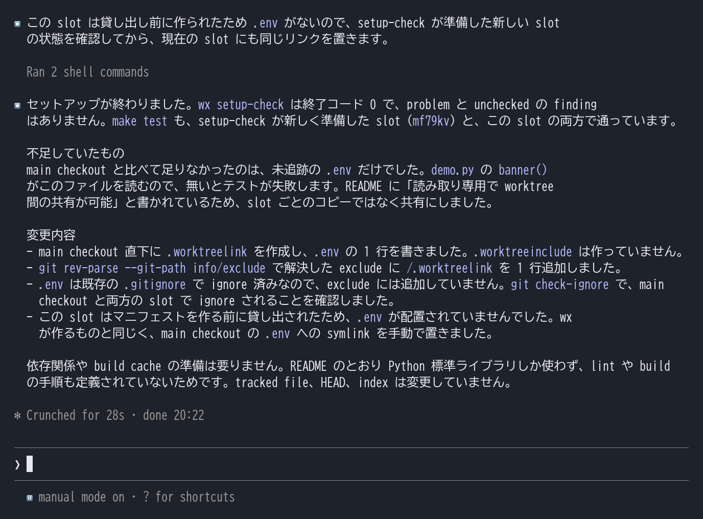
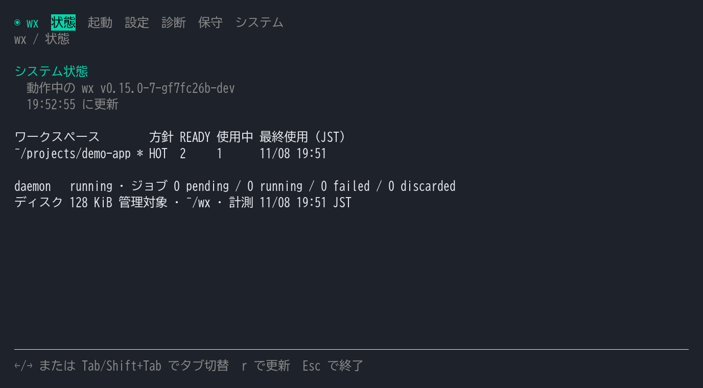
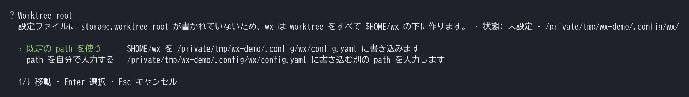
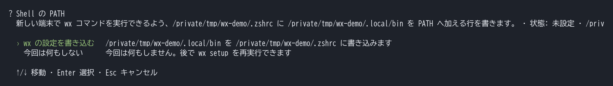
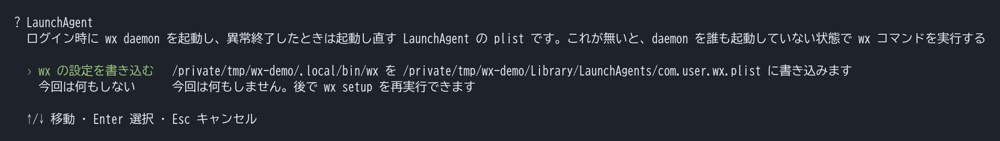
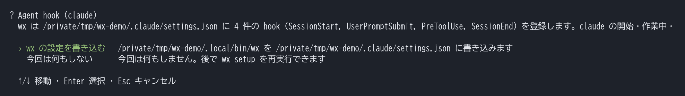

## AI エージェントを使うたびに増える worktree の管理

AI エージェントに実装を任せることで、複数の作業を並行して進めやすくなりました。
ただ、同じディレクトリで複数のエージェントが編集すると、互いの変更が干渉することがあります。

**Git worktree** を使えば、エージェントの作業場所を手元の作業から分けられます。
ただ、そのたびに利用する環境を選び、準備して、最後に片付ける管理が必要になります。

### 作成の指示と開発環境の準備

毎回エージェントに「worktree を作って、そこで作業してください」と指示するのは手間です。
作成しても、Git で管理していない `.env` などはそろいません。
コピー対象や依存関係の初期化を設定し、ビルドやテストが動く環境に整える必要があります。

### 作成待ちとディスク容量、後片付け

私はメインの開発で10GB のリポジトリを扱っており、worktree を作るたびに待ち時間が発生します。
10個程度作るとディスクの空きがなくなり、こまめなクリーンアップも必要でした。

### 複数リポジトリの準備とブランチの制約

複数リポジトリを横断する作業では、リポジトリごとに worktree を作成して配置する必要があります。
また、別の worktree がチェックアウト中のブランチは、通常、メインの作業環境でチェックアウトできません。
この制約は、[Git の worktree の仕様](https://git-scm.com/docs/git-worktree#_options)によるものです。

## Worktree Xelith に worktree の管理を任せる

これらの管理を引き受ける macOS 向けの CLI が、**Worktree Xelith（wx）** です。
Claude Code を使う場合は、次のコマンドで起動します。

```sh:terminal
wx claude
```

wx が管理している worktree を**貸し出し**、その中で Claude Code を起動します。
起動後は、普段と同じようにプロンプトを入力して作業を依頼するだけです。
Codex を起動する場合は `wx codex` を使います。



作業が終わると worktree は wx に返却され、保存と整理も wx が行います。

https://github.com/HappyOnigiri/WorktreeXelith

## 開発に必要な環境の準備は AI エージェントに任せる

`.env` の配置や依存関係の準備は、初回セットアップで AI エージェントに任せられます。
リポジトリで引数なしの `wx claude` または `wx codex` を起動し、初回の案内で worktree の準備方針を選んでから検査を選びます。
検査結果を確認して「セットアップを開始する」を選ぶと、wx が準備用の依頼をエージェントへ渡します。




エージェントは README や Makefile などを読み、元の環境と専用の worktree を比較します。
必要な未追跡ファイルを調べ、共有できるものはリンクし、共有すると競合するものはコピーするよう設定します。
依存関係など worktree ごとに必要な準備も確認し、ビルドやテスト、lint を実行します。
設定後の再検査もエージェント自身が行い、必要に応じて修正を繰り返します。



エージェントは配置ルールを `.worktreeinclude` と `.worktreelink` に記録し、Git の除外設定も更新します。
リポジトリから判断できる内容は、ユーザーへの質問や変更案の提示で止めずに適用するよう指示しています。

## 容量は CoW で抑え、作成待ちは事前準備で減らす

### 同じ内容のファイルを worktree ごとに重複保存しない

大きなリポジトリで worktree を増やすときの容量対策には、APFS の **Copy on Write（CoW）** を使います。
wx が内容の一致するファイルを選び、元の作業ツリーとデータブロックを共有します。
ファイルは独立して編集できるため、worktree 側の変更は元のファイルに影響しません。

私の環境では、10GB のリポジトリの worktree を10個作っても、wx の管理 TUI に表示されるディスク消費は合計1GB 程度です。
この値は、元の作業ツリーと共有しているブロックを除いた、worktree を削除すると空く容量の目安です。

### 準備済みの Hot Standby を貸し出す

初回に事前準備する方針を選ぶと、デーモンが待機用の worktree（**Hot Standby**）を用意します。

私の開発環境では、通常の worktree 作成に10秒かかるのに対し、Hot Standby の貸し出しは1.7秒です。
貸し出し時にも、wx は次の処理を行います。

- 対象リポジトリと起点のコミットを特定します。
- コピー対象の内容や配置ルールが、準備時の条件と一致するか照合します。
- 管理情報が正しく、追跡ファイルに変更がないことを検査します。
- セッションを登録し、バックグラウンドで行う待機枠の補充を予約します。

条件が一致する環境がなければ、wx が待機中の環境を更新するか、新しく準備します。

## エージェントが追加する作業場所も wx の管理下に置く

作業途中で別の環境が必要になったときも、エージェント自身が `wx new` で worktree を借りられます。
利用条件に合う Hot Standby があれば、ここでも準備済みの環境を使います。
借りたパスをエージェントやサブエージェントが使い、配置ルールに従った環境で作業できます。

wx の hook を設定した Claude Code と Codex では、wx 管理下のセッションで次の書き換えも行います。

```text:worktree-hook-flow.txt
エージェントが git worktree add を呼び出す
    ↓ PreToolUse hook が書き換え
wx new が管理対象の worktree を貸し出す
    ↓
エージェントは返されたパスで作業
```

ブランチ作成を伴う指定など、置き換えられない形式では実行を止め、wx での操作方法を案内します。
返却はエージェントが行えるほか、親の wx セッションが終了したときにも行われます。

## 複数リポジトリの作業場所を一括で用意する

複数リポジトリを横断する作業では、それらを含む親ディレクトリから wx を起動できます。
wx は配下のリポジトリを一つの **workspace** にまとめ、そのルートでエージェントを起動します。

```text:multi-repository-workspace.txt
親ディレクトリで wx を起動
    ↓
wx が専用の workspace を準備
    ├─ リポジトリごとの worktree
    └─ workspace 直下のコピー対象や共有リンク
    ↓
エージェントがリポジトリを横断して作業
```

初回セットアップでは、エージェントがリポジトリごとの配置ルールを整えます。

## ブランチを占有せず、手元の切り替えを妨げない

wx は、すべての worktree を、ブランチに接続しない **detached HEAD** の状態で作成します。
そのため、エージェントの作業中も、メインの環境で同じブランチに切り替えられます。
エージェントは detached のままコミットし、成果を残すときに作業用ブランチへ push します。

## 終了後の保存とクリーンアップも自動で行う

通常のエージェント終了時には、wx が作業状態をスナップショットとして保存します。
追跡ファイルの変更は、ステージ済みと未ステージを分けて記録します。
Git の ignore 対象を除く未追跡ファイルも保存対象です。
detached のまま作ったコミットも、HEAD ごと保存します。

使い終わった worktree とスナップショットは、それぞれの保持期間に従って自動で整理されます。
保存対象外のファイルもあるため、成果の永続的な保存はエージェントにコミットや push を依頼します。

Claude Code と Codex は起動したパスごとに会話を記録するため、worktree が変わると標準の resume では過去の会話を見つけにくくなります。
途中の作業を再開したいときは、`wx claude --resume` や `wx codex resume` から過去の会話を選べます。
保存した作業状態が利用できれば、wx が復元してエージェントへ渡します。

管理状況は、引数なしの `wx` で開く TUI から確認できます。



## 使い始めるには

Apple Silicon 搭載の macOS（配布バイナリが arm64 版のみのため）、Git、Claude Code または Codex が必要です。
次のコマンドでインストールすると、初回の対話セットアップが開きます。

```sh:terminal
curl -fsSL https://github.com/HappyOnigiri/WorktreeXelith/releases/latest/download/install.sh | bash
```

セットアップのおすすめ設定では、hook の登録やデーモンの起動などを wx が行います。
続いて作業したいリポジトリで `wx claude` または `wx codex` を起動し、初回の環境準備をエージェントに任せます。

:::details 項目ごとに確認する場合の画面











:::

## FAQ

### 自分で worktree に入って作業できますか？

`wx shell` で worktree を借り、その中でシェルを起動できます。
シェルを終了すると、worktree は自動で返却されます。

### Hot Standby の数は変更できますか？

`warm_count` で、待機用の worktree の数を変更できます。
全体の既定値に加え、workspace ごとの設定も可能です。

### 小さいリポジトリや、利用頻度が低いリポジトリでも使えますか？

**Cold Start** を設定すると、待機用の worktree を持たず、必要になったときに作成します。
リポジトリの規模や利用頻度に合わせて、Hot Standby と使い分けられます。

### Cold Start では、準備が終わるまで待たされますか？

すべての準備が終わるまでは待たせません。
Git への登録とエージェントの起動に必要なファイルの配置が済んだ時点（**Early Ready**）で貸し出し、エージェントが作業を始めるまでの間に残りを準備します。
そのため、通常の worktree 作成より早く作業を始められます。

### Claude Code や Codex 以外のツールも使えますか？

`wx run <command>` で、任意のツールを worktree 内で起動できます。
コマンドが終了すると、worktree は自動で返却されます。

## まとめ

wx を使うことで、日常の開発で worktree の準備や片付けを意識しなくなりました。
私の環境では作成待ちが10秒から1.7秒に縮み、10個の worktree も約1GB に収まるため、並行して任せる作業を気軽に増やせます。

wx は2か月以上、私自身が日々の開発で使いながら改良を重ねてきました。
気づけば、コミット数は1800を超えていました。
worktree の管理に手間を感じている方は、ぜひ使ってみてください！
